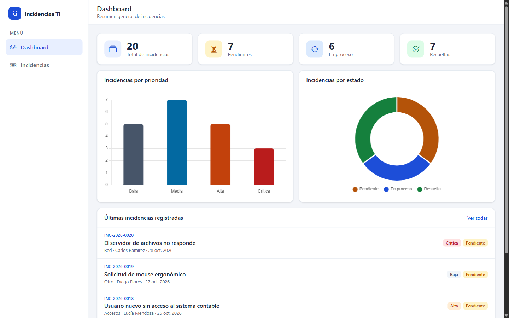
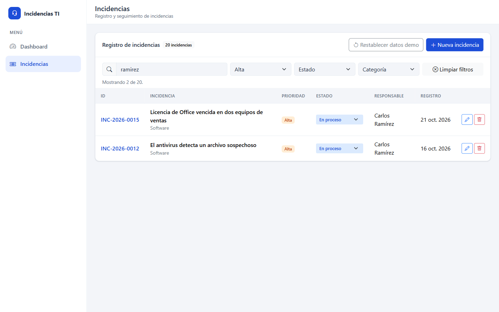
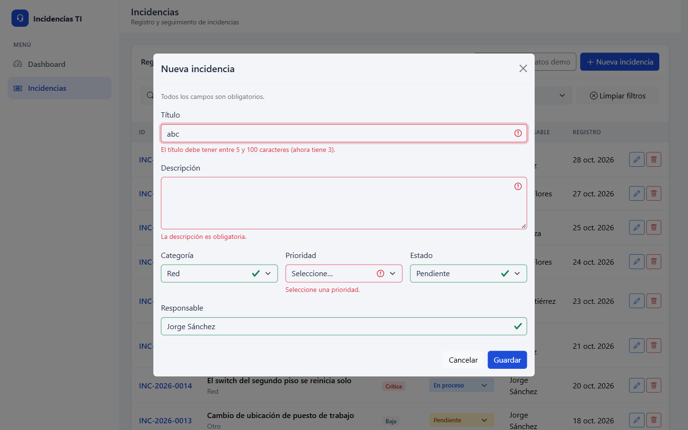
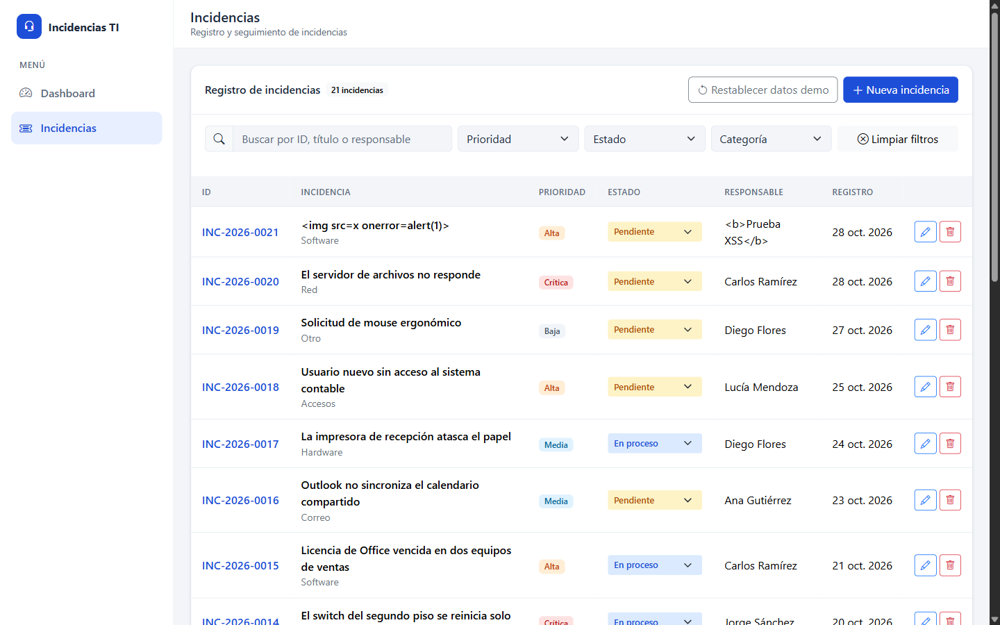
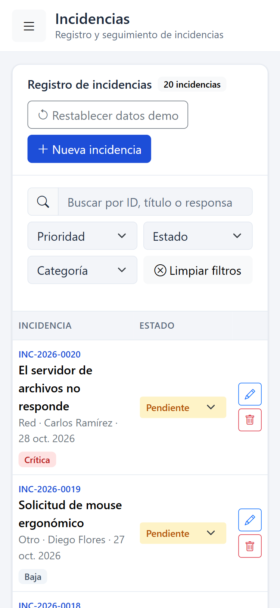

# Sistema de Gestión de Incidencias TI

Aplicación web para registrar, priorizar y dar seguimiento a incidencias de soporte técnico (hardware, software, red, accesos, correo). Funciona completamente en el navegador: **HTML, CSS y JavaScript vanilla** con módulos ES, sin frameworks, sin backend y sin herramientas de compilación. Los datos se guardan en `localStorage`.


## Capturas

| Dashboard | Gestión de incidencias |
|---|---|
|  |  |

| Búsqueda con filtros combinados | Validación por campo |
|---|---|
|  |  |

| Prueba de XSS | Móvil (375 px) |
|---|---|
|  |  |

## Funcionalidades

**Dashboard**
- Indicadores de total, pendientes, en proceso y resueltas.
- Gráfico de barras por prioridad y gráfico de dona por estado (Chart.js), que se actualizan sin recargar cuando cambian los datos, incluso si el cambio se hizo en otra pestaña.
- Las 5 incidencias registradas más recientemente.

**Gestión de incidencias**
- Registrar, editar y eliminar incidencias. Eliminar pide confirmación en un modal.
- Cambiar el estado directamente desde la tabla, sin abrir el formulario.
- Búsqueda por ID, título o responsable, sin distinguir tildes ni mayúsculas, combinable con filtros de prioridad, estado y categoría.
- Validación con mensajes por campo usando las clases de Bootstrap (`is-invalid` / `is-valid`).
- IDs legibles con formato `INC-2026-0001`: el correlativo se guarda aparte y nunca se reutiliza tras eliminar.
- Fecha de registro automática y fecha de actualización que solo cambia cuando realmente hubo cambios.

**Datos de demostración y robustez**
- 20 incidencias de ejemplo que se cargan solo en la primera visita, con fechas relativas al día actual.
- Botón **Restablecer datos demo** con confirmación.
- Si `localStorage` contiene datos dañados (JSON inválido o con formato inesperado), la app no se rompe: muestra un aviso con el detalle técnico y ofrece restablecer, sin borrar nada por su cuenta.

## Tecnologías

| Área | Tecnología |
|---|---|
| Estructura y estilos | HTML5 semántico, CSS3 con variables (`:root`) |
| Lógica | JavaScript vanilla con módulos ES (`import`/`export`) |
| Interfaz | Bootstrap 5.3 (layout, modales, offcanvas, toasts) y Bootstrap Icons |
| Gráficos | Chart.js 4.4 |
| Persistencia | `localStorage` |
| Publicación | GitHub Pages |

Las librerías se cargan por CDN con *Subresource Integrity* (atributo `integrity`), así el navegador rechaza cualquier archivo alterado.

## Estructura del proyecto

```
sistema-incidencias/
├── index.html               # Única página: sidebar, cabecera, vistas Dashboard e Incidencias y modal del formulario
├── css/
│   └── styles.css           # Paleta en variables CSS, layout, tabla responsive, badges
├── js/
│   ├── app.js               # Arranque, navegación por hash (#dashboard / #incidencias), aviso de datos dañados
│   ├── config.js            # Catálogos (categorías, prioridades, estados), límites de longitud, claves de localStorage
│   ├── storage.js           # Único módulo que toca localStorage: lectura validada, escritura, correlativo de IDs
│   ├── demo-data.js         # Las 20 incidencias de demostración
│   ├── incidencias.js       # Lógica pura: sanitizar, validar, CRUD, cambiar estado, filtrar (sin DOM)
│   ├── vista-incidencias.js # Tabla, filtros, selector de estado, formulario y eliminación
│   ├── dashboard.js         # Indicadores, gráficos y últimas incidencias
│   └── ui.js                # Creación segura de elementos, badges, toasts, modal de confirmación, fechas
└── docs/screenshots/        # Capturas de este README
```

El código está separado en tres capas: **datos** (`storage.js`), **lógica** (`incidencias.js`, sin DOM, probable desde la consola) y **vistas** (`dashboard.js`, `vista-incidencias.js`). Cada vez que se guardan datos se emite un evento propio (`incidencias:cambio`) y las vistas se redibujan solas.

## Ejecución local

Los módulos ES no cargan abriendo `index.html` con doble clic (`file://`): el navegador los bloquea por seguridad. Hace falta un servidor estático. Cualquiera de estas opciones sirve:

- **VS Code + Live Server:** clic derecho en `index.html` → *Open with Live Server*.
- **Python 3**, desde la carpeta del proyecto:
  ```powershell
  python -m http.server 5500 --bind 127.0.0.1
  ```
  Luego abre http://127.0.0.1:5500/

No hay dependencias que instalar ni pasos de compilación.

## Decisiones técnicas

- **Seguridad contra XSS.** Ningún dato del usuario se inserta con `innerHTML`, `insertAdjacentHTML` ni plantillas HTML. Todo el DOM dinámico se construye con `createElement` y `textContent`, así que un título como `` se muestra como texto y nunca se ejecuta (ver la captura). Tampoco hay estilos ni scripts en línea, lo que permitiría activar una política de seguridad (CSP) estricta.
- **Sanitización y validación.** Antes de guardar se quitan espacios sobrantes y caracteres de control, y se valida la longitud con los límites de `config.js` (título 5–100, descripción 10–1000). La misma función valida en el formulario y en la capa de lógica, así que las reglas existen una sola vez.
- **Desconfiar de `localStorage`.** Lo que se lee puede haber sido editado a mano. `JSON.parse` va protegido y cada incidencia se valida: tipos, valores de los catálogos, fechas e IDs únicos. Si algo no cuadra, se avisa en lugar de fallar.
- **IDs que no se reutilizan.** El correlativo se guarda aparte y solo avanza. Si se calculara como "cantidad + 1", al eliminar una incidencia se repetiría un ID y el historial sería ambiguo.
- **Tabla responsive accesible.** En lugar de convertir las filas en tarjetas (lo que hace que los lectores de pantalla dejen de reconocer la tabla), las columnas secundarias se ocultan según el ancho y su contenido se repite dentro de la celda principal: 7 columnas desde 1400 px, 4 desde 768 px y 3 en teléfonos.
- **Accesibilidad.** Etiquetas en todos los campos, `aria-label` en los botones de icono, `aria-describedby` para los errores, gráficos con descripción en texto, foco gestionado al navegar y al cambiar estados, contraste WCAG AA y respeto por la preferencia "reducir movimiento". Lighthouse da 100 en accesibilidad en escritorio y móvil.
- **Rutas relativas.** Todas las rutas son relativas (`js/app.js`, no `/js/app.js`) para que funcione en la subruta de GitHub Pages (`usuario.github.io/sistema-incidencias/`).

**Limitación conocida:** al usar `localStorage`, los datos viven solo en el navegador donde se crearon. No se comparten entre dispositivos ni usuarios; para eso haría falta un backend.

## Publicar en GitHub Pages

1. En el repositorio de GitHub: **Settings → Pages**.
2. En **Build and deployment → Source**, elige **Deploy from a branch**.
3. En **Branch**, elige **`main`** y la carpeta **`/ (root)`**, y pulsa **Save**.
4. En uno o dos minutos el sitio queda disponible en https://adriaaanzd.github.io/sistema-incidencias/

## Autor

**Adrian Castillo** · [github.com/adriaaanzd](https://github.com/adriaaanzd)
